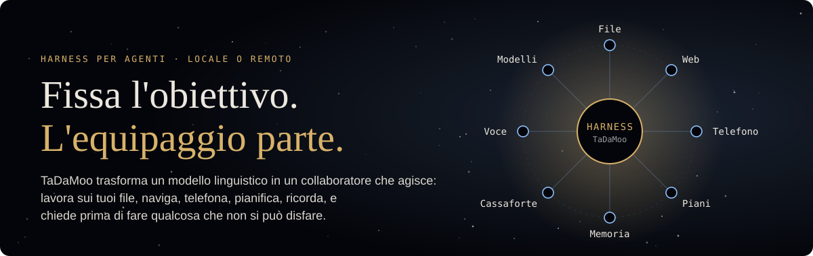
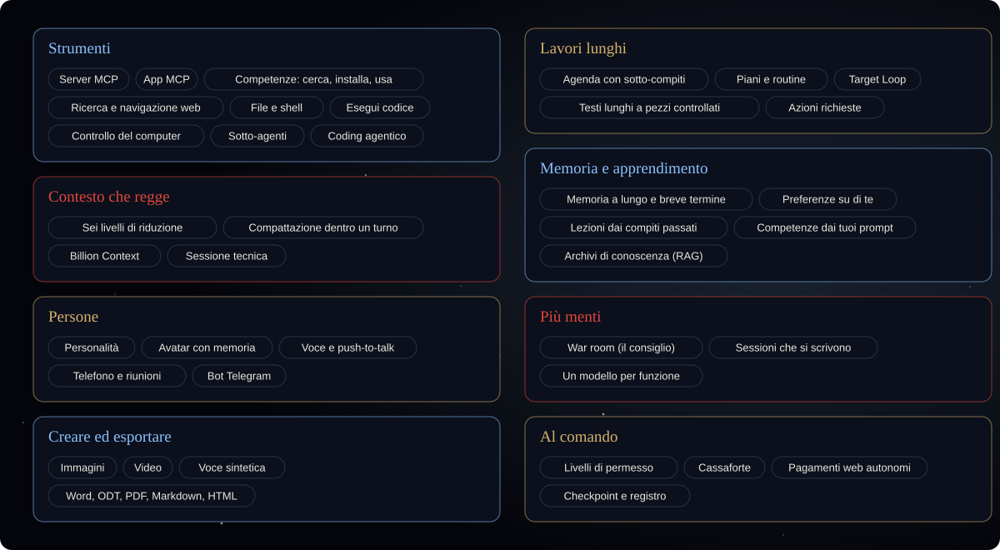
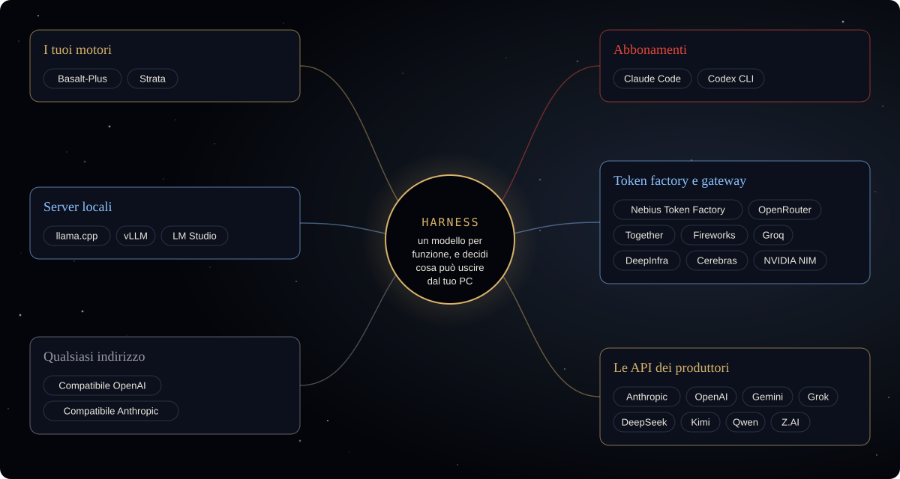
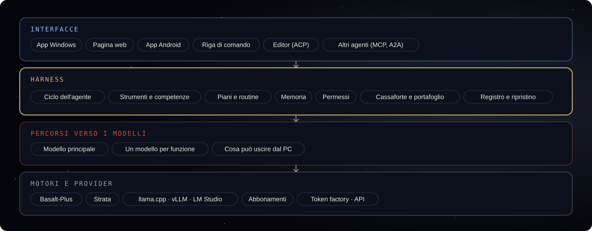

<p align="center">
  
</p>

<p align="center">
  <a href="https://tadamoo.com">tadamoo.com</a> ·
  <a href="#installazione">Installazione</a> ·
  <a href="#cosa-fa">Cosa fa</a> ·
  <a href="#qualsiasi-modello-in-qualsiasi-modo">Modelli</a> ·
  <a href="docs/harness-manual.it.md">Manuale</a> ·
  <a href="README.md">English</a> · Italiano
</p>

# TaDaMoo

**TaDaMoo è un harness per agenti: la parte che trasforma un modello linguistico in un collaboratore.** Un modello da solo risponde a domande. Con TaDaMoo attorno, lo stesso modello legge e modifica i tuoi file, cerca e naviga sul web, guida il computer con mouse e tastiera, compila moduli e prenota, telefona, tiene in marcia i piani anche di notte, ricorda chi sei, impara da ciò che è fallito e ti chiede il permesso prima di fare qualcosa che non si può disfare.

Il modello lo scegli tu: un motore sulla tua scheda video, un abbonamento che già paghi, una token factory o un server nella tua rete. Scegli tu anche quanta libertà ha. Ogni azione finisce in un registro che puoi rileggere, e ogni file toccato può essere rimesso com'era.

> **Licenza.** TaDaMoo non è con licenza MIT e non è open source in quel senso. Il suo codice nuovo e modificato è sotto la **Basalt Win+GUI Community and Commercial License** ([LICENSE](LICENSE)): gratis per le persone (uso personale, di ricerca, per hobby, didattico e sperimentale) e per le organizzazioni con ricavi annui lordi **inferiori a 10.000.000 USD**; un'organizzazione pari o sopra quella cifra ha bisogno di una Enterprise Commercial License scritta per usarlo in produzione, e nessuno può offrirlo come servizio gestito a pagamento o API ospitata senza un accordo a parte. Vedere il sorgente su GitHub non dà nessun altro diritto. Licenze commerciali: [a.taini@gmail.com](mailto:a.taini@gmail.com). I dettagli sono in [Licenza](#licenza).

## Perché si usa

- **Fa il lavoro.** File, shell, web, moduli, documenti, piani e il computer stesso, da una sola conversazione.
- **Va avanti quando ti allontani.** Piani e routine girano da soli. Ciò che richiede davvero una persona aspetta in un'unica lista, le [Azioni richieste](docs/actions.md), sul PC, nel browser e come notifica sul telefono.
- **Ricorda chi sei e impara.** Memoria a lungo e breve termine su di te, lezioni su ciò che è fallito e su ciò che ha funzionato, e competenze che costruisce dai tuoi stessi prompt.
- **Costa meno più lo usi.** Un compito che ripeti diventa uno script: il modello lo scrive una volta, poi è codice normale e il modello interviene solo dove serve capire il linguaggio.
- **Il lavoro lungo non lo soffoca.** Sei livelli tengono la conversazione dentro la finestra di contesto, una sessione tecnica fa le pulizie perché il contesto principale resti libero, e i testi lunghi si scrivono a pezzi controllati.
- **Le redini sono tue.** Quattro livelli di permesso, una cassaforte che tiene password e carte lontane dal modello, un checkpoint per ogni file e un registro a catena di hash di ogni azione.
- **Qualsiasi modello, cambiabile.** Cambi il modello principale in un punto solo, oppure ne dai uno a ciascuna funzione.
- **Ti segue.** App Windows, qualsiasi browser, app Android, un bot Telegram, riga di comando, oppure il tuo editor via ACP. Un solo server può servirli tutti.

## Cosa fa

<p align="center">
  
</p>

Tutto ciò che segue è nel repository. Il [manuale](docs/harness-manual.it.md) dice come usare ogni funzione e il [riferimento](docs/harness.md) come funziona.

### Strumenti che crescono
- **Server MCP e app MCP.** Gli strumenti di qualsiasi server MCP, con accesso (OAuth) ai server remoti, e la pagina di un'app MCP mostrata accanto alla conversazione (il lato host dell'estensione ufficiale). Vedi [app MCP](docs/mcp-apps.md).
- **Competenze e plugin, trovati, installati e usati.** Competenze, plugin e server MCP presenti sul PC sono usabili subito. Se ne manca uno lo cerca online, ti mette davanti i candidati migliori (in coda con un confronto se nessuno c'è) e ne installa uno con il tuo sì, o da solo in Automatico; un'installazione non esegue mai gli script di un pacchetto. A mano: *Impostazioni > Skills* o `/install-skill`; ogni competenza è anche un comando, `/nome testo`. Vedi [competenze](docs/skills-manager.md).
- **Il web.** `search_web`, `browse_url`, e Edge o Chrome guidati per moduli, prenotazioni e acquisti, in un browser costruito attorno alla cassaforte: una password o una carta arriva a una pagina solo come segnaposto, e solo su un sito che la voce nomina. Due driver stanno dietro un selettore nel Wallet: **agent-browser** di Vercel Labs (il predefinito; viene con TaDaMoo, istantanee compatte delle pagine, schede, sessioni, video, collegamento al tuo Chrome) oppure il driver di TaDaMoo. Entrambi gestiscono cassaforte, accessi e pagamenti; agent-browser non è ancora alla pari del driver nostro, e [la pagina dei browser](docs/browser-backends.md) dice dove.
- **Controllo del computer.** Undici strumenti: uno screenshot, l'albero di accessibilità di qualsiasi finestra (così anche un modello senza visione agisce per elemento), mouse, tastiera, scorrimento e trascinamento, sullo schermo che scegli, con arresto immediato se porti il mouse in un angolo. Attivo di default, entro i livelli di permesso. Usa **agent-desktop** di Vercel Labs, che viene con TaDaMoo e legge l'albero di accessibilità di Windows, Linux e macOS e agisce sugli elementi senza muovere il tuo mouse; il backend interno (Windows e X11, senza dipendenze) è la riserva. Vedi [controllo del computer](docs/computer-control.md).
- **File e documenti.** Legge, elenca, cerca, modifica e scrive file; allega testo, codice, CSV, JSON, Word, Excel, PowerPoint, PDF e immagini, letti a pezzi; `docx_edit` e `docx_create` per i documenti Word. I file che crea vengono controllati prima di offrirli, e un pulsante con il nome del file li salva dove scegli.
- **Intelligenza sul codice.** `repo_map` (le definizioni di ogni file sorgente, le più rilevanti prima), `repo_diagram` (diagrammi di importazioni e cartelle ricavati dai file, senza modello), `search_code`, diagnostica dei language server e vai-alla-definizione.
- **Eseguire codice e delegare.** Frammenti Python, JavaScript e TypeScript, comandi di shell, comandi in background, e sotto-agenti per un compito a sé.
- **Altri agenti.** L'agente di qualsiasi editor che parli ACP (su stdio), un client ACP e un client A2A per dialogare con altri agenti. Vedi [riferimento dell'harness](docs/harness.md).
- **Coding agentico.** Un ruolo per ogni conversazione, le verifiche che un progetto sembra avere, una classe di comandi di verifica sicuri, un worktree tutto suo per una conversazione su una cartella git e blocchi di modifiche che tieni o annulli. Vedi [modalità coding](docs/coding-mode.md).
- **Toolkit di reverse engineering.** Un interruttore opzionale aggiunge il toolkit REA (server MCP e competenza) e i programmi che può usare, ciascuno installato solo con un clic; sperimentale su Windows. Vedi [REA](docs/rea.md).

### Conversazioni che puoi guidare
- **Una colonna di conversazioni** da aprire, cancellare o contrassegnare, con la modalità e il livello di pensiero di ciascuna: *Solo piano*, *Sola lettura*, *Chiedi prima*, *Automatico* (Shift+Tab la cambia), e un livello di pensiero per conversazione.
- **Più di trenta comandi con la barra**: sulla pagina (`/clear`, `/mode`, `/plan`, `/copy`, `/export`, `/branch`, `/rewind`, `/stop`, `/diff`), risposti dal processo della conversazione (`/status`, `/context`, `/compact`, `/tools`, `/hooks`, `/mcp`, `/memory`, `/permissions`, `/audit`), richieste per il modello (`/init`, `/review`, `/security-review`, `/research`) e ogni competenza.
- **Un messaggio mentre lavora** viene guidato nel compito, messo in coda o trattato come urgente; **Stop** vuol dire stop. Conosce sempre data, ora e fuso locali, senza chiamare uno strumento.
- **Chiede bene.** Una scheda con scelte, una riga tua e l'opzione consigliata per prima; guarda ogni richiesta prima di lavorare; suggerimenti per il tuo messaggio successivo che riempiono solo la casella; una riscrittura facoltativa di ogni messaggio. Le esecuzioni senza persona non aspettano mai nulla di tutto ciò. Vedi [intake](docs/intake.md).
- **Risposte che mostrano il lavoro.** Immagini trovate sul web con la fonte nominata, grafici e diagrammi che la pagina disegna, un pulsante *fonte* che apre la pagina usata, e pulsanti per i file.
- **Ricorda le conversazioni passate.** Un solo indice di tutto ciò di cui hai parlato, cercato dall'agente (`search_past`) e da te.
- **Un guasto si gestisce, non si nasconde.** Un server occupato o irraggiungibile viene riprovato, un processo che muore riparte dalla sua cronologia, una chiamata a uno strumento malformata viene riparata, e cicli e limiti di tempo fermano un compito che non va da nessuna parte.

### Rivedere, annullare, rigiocare
- **Pannello delle modifiche.** Ogni modifica, blocco per blocco, con *Tieni* e *Annulla*; un blocco si annulla solo finché il file è esattamente ciò che l'agente ha scritto, e le modifiche fatte da un comando di shell sono elencate pure.
- **Checkpoint e ripristino.** Prima di un'azione che cambia file, il loro contenuto precedente viene conservato fuori dal progetto; `/rewind`, *Torna qui* e *Impostazioni > Checkpoints* lo ripristinano, e un ripristino fa prima un'istantanea di sicurezza.
- **Rami.** `/branch` copia una conversazione a una richiesta; un albero li mostra; *Esegui entrambi e confronta* manda una richiesta lungo due continuazioni e mostra le risposte e i file che ciascuna ha cambiato affiancati; *Unisci e riassumi* scrive una sintesi di due rami.
- **Una copia della cartella.** Su una cartella git una conversazione può lavorare in un worktree e tu applichi i diff che scegli come modifiche in staging, mai un commit.
- **Replay e tracce.** Una sessione registrata si rigioca con le sue risposte registrate (non esegue nulla) e si salva come JSONL con i segreti mascherati; il registro delle azioni si verifica dalla stessa pagina.

### Lavori lunghi, senza perdere il filo
- **Un'agenda di compiti.** Un registro di ciò che è aperto in ogni progetto, con sotto-compiti fino a dieci livelli, ciò che è fatto e ciò che manca. Sopravvive alla compattazione, e tu e l'agente modificate la stessa lista. Vedi [il registro](docs/task-register.md).
- **Piani.** Un obiettivo diventa un piano a grafo di azioni, sensori, decisioni, unioni e compiti affidati a te; un passo fallito riscrive il piano, con storico e ripristino; un piano può avviarne un altro, partire a un'ora che dici a parole ed essere eseguito come script. Vedi [orchestrazione](docs/orchestration.md).
- **Routine** eseguono una richiesta in una cartella a orario, sempre in Automatico. Le **Azioni richieste** mettono in una lista sola tutto ciò che aspetta te.
- **Target Loop.** Lavora su un obiettivo finché è raggiunto, si blocca o lo fermi tu, giudicando ogni risultato su prove. Vedi [il Target Loop](docs/target-loop.md).
- **Testi lunghi.** Una richiesta troppo lunga per una sola risposta (un capitolo, una relazione, una traduzione lunga) viene pianificata a parti, ciascuna scritta in una chiamata a sé, controllata e corretta, poi si ricontrolla il tutto. Una risposta tagliata dal limite di output continua da sola. Vedi [risposte lunghe](docs/longform.md).

### Un contesto che regge
- **Sei livelli di riduzione**, in ordine mentre il contesto si riempie: limiti sull'output degli strumenti, mascheramento dei risultati vecchi, compattazione dei passi più vecchi (anche dentro un solo turno di centinaia di chiamate), una politica per la chat piena (riassumere il centro, scartare i turni più vecchi o fermarsi), record brevi per le vecchie risposte lunghe e il proxy **Billion Context**; sopra, modelli di riassunto e finestra scorrevole. Vedi [i livelli](docs/context-layers.md) e [la compattazione](docs/compaction.md).
- **Una sessione tecnica.** Una sessione a lato (se vuoi, un secondo modello piccolo) fa le pulizie: compatta, controlla le risposte, riscrive un prompt, giudica la pertinenza, rifinisce le lezioni. La conversazione principale resta pulita e si spende poca VRAM.
- **Un controllo su ogni risposta.** Una catena di giudici guarda una risposta prima che ti arrivi.

### Memoria e apprendimento
- **Memoria a breve e a lungo termine.** Su di te: chi sei, dove vivi, le persone della tua vita, i tuoi gusti, e cosa hai cercato o fatto di recente. Cifrata su disco, leggibile e modificabile da te, con un interruttore per ciò che può andare a un modello in cloud. Accanto, gli appunti di progetto, le regole di `AGENTS.md` lette dalla cartella in su e i documenti di riferimento.
- **Lezioni dai compiti passati.** Cosa è fallito, cosa ha funzionato e come evitare l'errore, in Markdown che puoi modificare, per un progetto e per ovunque; ogni compito lascia una riga in un registro degli esiti.
- **Competenze fatte dai tuoi prompt.** Premi *Make a skill* sotto una richiesta, segna ciò che cambia, e l'harness tiene ciò che hai fatto come uno script da rieseguire, su questo PC o su un altro (un solo file `.pskill`).
- **Archivi di conoscenza (RAG).** Documenti per progetto, letti, divisi per struttura, trasformati in vettori e cercati per significato e per parole, con figure e fonti. Vedi [RAG](docs/rag.md).

### Personalità, avatar e voce
- **Personalità.** Un nome, un modo di parlare, un prompt fisso, una lingua, una voce, un avatar e una memoria tutta sua che può imparare da ogni conversazione. Sei colleghi pronti sono a un pulsante di distanza: **Il Critico** cerca prima ciò che non va; **L'Analitico** ragiona per parti, numeri e ipotesi; **Il Pignolo** caccia il dettaglio che non torna; **Lo Scettico** vuole le prove; **Il Pragmatico** vuole la cosa più semplice che funziona, presto; **Il Sintetico** risponde prima e si ferma. Li modifichi o li cancelli come ogni altro. Vedi [personalità](docs/personas.md).
- **Voce.** Riconoscimento vocale (Whisper) e sintesi con Kokoro, Piper, XTTS v2, Chatterbox, CosyVoice 3, Qwen3-TTS, Orpheus e Dia, una voce per ogni personalità, voci clonate conservate sul tuo PC.
- **Avatar.** Un volto con una voce: sul telefono con Wav2Lip o forme della bocca, senza GPU; sul PC con MuseTalk, Wav2Lip v2, SadTalker ed ER-NeRF, oppure addestrato una volta da un video della persona (Ultralight-Digital-Human, FeatherTalk). Ciascuno ha la personalità e la memoria sue.
- **Parla come una persona.** Puoi interromperlo: la voce si abbassa e ricorda ciò che non aveva ancora detto. Segue la lingua in cui parli. Tieni premuto per parlare o continuo, dettatura con tasto rapido, push-to-talk e cronologia degli appunti sul desktop, e un terminale ESP32.
- **Telefono e riunioni.** L'assistente può entrare in Meet, Teams o Zoom come ospite dichiarato e suggerire risposte, e fare o ricevere telefonate con un modem GSM o il telefono, con una sola regola che chiede ogni volta. Vedi [voce](docs/voice/service.md).
- **Telegram.** Un bot che parla con l'agente con le stesse funzioni. Vedi [Telegram](docs/telegram.md).
- **Importazione** da callAPIcall: personalità, video, memoria e l'avatar preparato.

### Più menti
- **War room.** Un consiglio di consiglieri con ruoli (proponente, critico, ingegnere) e un moderatore discute una domanda difficile giro dopo giro finché concordano. Ogni consigliere può avere un suo modello e una sua personalità, così più LLM discutono lo stesso problema. Il costo si vede prima. Vedi [il consiglio](docs/council.md).
- **Sessioni che si scrivono.** Scrivi `@` e scegli una sessione: riceve il tuo testo, una ferma si risveglia e lavora, e entrambe le conversazioni mostrano lo scambio. Vedi [messaggi tra sessioni](docs/session-messaging.md).
- **Un modello per funzione.** Chat, ciclo dell'agente, voce, pianificatore, compattazione, i controlli, lavori rapidi, pertinenza e archivi di conoscenza possono usare ciascuno un modello diverso, con il tuo sì per quelli che escono dal PC.

### Creare ed esportare
- **Immagini e video** dalla chat con modelli che stanno accanto al modello linguistico (`generate_image`, `generate_video`), e voce sintetica con molte voci. Vedi [media](docs/media/README.md).
- **Esportare una conversazione** in Word, OpenDocument, PDF, Markdown o HTML, con la selezione che scegli.

### Telefoni e remoto
- **L'app Android**: chat, voce, avatar, una scheda dell'agente, una scheda delle azioni che ti aspettano con notifiche standard, e un menu **+** per immagini, foto e documenti dal telefono, dal server o dalla rete. Uno strumento del telefono dice all'agente dove ti trovi.
- **Telefoni configurati dal PC**: *Impostazioni > Phones* installa Tailscale, fa collegare i telefoni con una chiave mostrata come QR e dà a ogni telefono la sua chiave.
- **Server remoti**: l'app desktop si collega a un server altrove, la chiave si cambia dalla pagina, dall'app e da qualsiasi client collegato, e un server può girare senza alcuna pagina web.

### Restare al comando
- **Quattro livelli di permesso** per conversazione, *Solo piano*, *Sola lettura*, *Chiedi prima* e *Automatico*, con modalità piano, regole che scrivi come hook e una classe di comandi di verifica sicuri. Le esecuzioni senza persona non aspettano mai; resta in coda solo ciò che coinvolge altre persone, una prenotazione o una risorsa che l'agente non controlla.
- **Il testo non fidato resta testo.** Pagine, file e risultati degli strumenti sono racchiusi come dati, un cancello delle istruzioni e un controllo della Regola dei Due vigilano contro l'iniezione di prompt, e ciò che dice una lezione salvata non è mai obbedito come un ordine.
- **La cassaforte Wallet** tiene cifrati carte, dati personali e accessi; il modello scrive solo segnaposto riempiti all'ultimo passo, e l'agente può pagare sul web entro i limiti che imposti. Un broker dei segreti tiene le chiavi lontane dal modello.
- **Ogni azione è registrata** in un registro che si può solo aggiungere, a catena di hash, con un checkpoint prima di ogni modifica.
- **Un monitor di sicurezza** osserva le connessioni di rete e le scritture su disco dei processi del modello, e avvia il test di esfiltrazione Openweight Canary. Vedi [il riferimento dell'harness](docs/harness.md).

### Misurarlo
- **Valutazione** (`python -m tadamoo.eval`): pass^k, costo e uso della cache. **L'energia di un compito**: potenza e wattora mentre girava. Replay di una sessione registrata. Vedi [il riferimento dell'harness](docs/harness.md).

## Qualsiasi modello, in qualsiasi modo

<p align="center">
  
</p>

TaDaMoo non è legato a un solo motore o a un solo fornitore. Impostazioni > Providers contiene i collegamenti, e ciascuna funzione dell'harness può usare il modello principale o uno suo. Decidi anche cosa può uscire dal tuo PC.

- **I tuoi motori.** Due, uno attivo alla volta, entrambi eseguiti dallo stesso server:
  - **Basalt-Plus** è la nostra revisione di Basalt (a sua volta un fork di Strata) per NVIDIA Blackwell. Esegue Qwen3.8-Flash-Next con gli esperti distribuiti su scheda video, seconda scheda, RAM e CPU, aggiunge un port nativo per Windows e un Loader che prevede memoria e velocità prima di caricare qualsiasi cosa.
  - **Strata** copre l'hardware che Basalt-Plus non copre: RTX 20, 30 e 40, AMD, Intel, Apple silicon e macchine a memoria unificata, con i modelli Qwen3.6 e DeepSeek. Gira come processo figlio gestito dallo stesso server, con una sua scheda dei modelli nel Loader.
- **Abbonamenti.** Claude con il tuo abbonamento Claude Code e OpenAI con il tuo abbonamento Codex CLI.
- **Token factory e gateway.** Nebius Token Factory, OpenRouter, Together, Fireworks, Groq, DeepInfra, Cerebras, Hyperbolic, Novita, SiliconFlow, Chutes, NVIDIA NIM e OrcaRouter.
- **Le API dei produttori.** Anthropic, OpenAI, Gemini, Grok, DeepSeek, Kimi, Qwen e Z.AI (piano API e piano coding).
- **Server locali.** llama.cpp (`llama-server`), vLLM e LM Studio, più qualsiasi indirizzo che parli l'API OpenAI o Anthropic.

Il server parla entrambe le API anche verso l'esterno, così gli editor e gli strumenti che usi già possono dialogare con il modello che TaDaMoo sta servendo. Vedi [i motori](docs/engines-protocol.md) e [l'API del server](docs/reference/server-api.md).

## Dappertutto

<p align="center">
  
</p>

- **App Windows** con il server locale, il Loader e una finestra su qualsiasi server; un'installazione solo-GUI quando il server sta altrove.
- **Un server su Linux**, Docker o Kubernetes, raggiunto da un browser, dall'app desktop o dal telefono, dietro il tuo proxy e la tua chiave. La chiave si cambia dalla pagina, dall'app e da qualsiasi client collegato.
- **App Android** con chat, voce, avatar e una scheda delle azioni che ti aspettano, con notifiche standard.
- **Telegram, riga di comando ed editor**: `python -m tadamoo -p "compito"`, e l'agente di qualsiasi editor che parli ACP.

## Installazione

**Release attuale: 2.4, *victory-lap*.**

| Cosa | Dove | Per |
|---|---|---|
| **Windows**, completo | [windows-v2.4](https://github.com/nuspy/tadamoo/releases/tag/windows-v2.4) | app, motore, server e Python su un solo PC |
| **Windows**, solo GUI | [windows-gui-only-v2.4](https://github.com/nuspy/tadamoo/releases/tag/windows-gui-only-v2.4) | una finestra su un server che gira altrove |
| **Linux**, completo | [linux-complete-v2.4](https://github.com/nuspy/tadamoo/releases/tag/linux-complete-v2.4) | harness, installer e motore Basalt-Plus |
| **Linux**, server | [server-linux-v2.4](https://github.com/nuspy/tadamoo/releases/tag/server-linux-v2.4) | harness e installer |
| **Android** | [android-v2.4](https://github.com/nuspy/tadamoo/releases/tag/android-v2.4) | l'app per il telefono |
| **Mac** | da compilare da questo repository | la finestra su un server (predisposto in [deploy/mac](deploy/mac/README.md)) |

agent-desktop e agent-browser (Vercel Labs, Apache-2.0) sono compilati da `third_party/` e stanno dentro i pacchetti Windows e Linux.

Su Linux:

```
tar xzf TaDaMoo-linux-complete-v2.4.tar.gz && cd tadamoo-2.4
sudo deploy/linux/install.sh install --components harness,basalt --public-name tadamoo.example.org --proxy nginx --generate-key
```

L'installer prende i motori che chiedi (`--components harness,basalt,strata`), scrive il servizio systemd e una ricetta pronta per nginx, Caddy o Nginx Proxy Manager, e scarica Strata dalla sua release con controllo del checksum (`--strata-download`). In `deploy/` ci sono i file Docker e un chart Helm per Kubernetes e k3s. Vedi [docs/deploy.md](docs/deploy.md).

Basalt-Plus richiede una scheda NVIDIA Blackwell (serie RTX 50, compute capability 12.0). Senza, l'harness funziona comunque con uno qualsiasi dei provider qui sopra.

## Per saperne di più

- [Manuale](docs/harness-manual.it.md) e [riferimento dell'harness](docs/harness.md)
- [Installare su un server](docs/deploy.md), [l'app desktop e i server remoti](docs/desktop-servers.md), [solo GUI per Windows](docs/windows-gui-only.md), [sicurezza del server](docs/server-security.md)
- [Azioni richieste](docs/actions.md), [orchestrazione: piani, routine, cron](docs/orchestration.md), [il consiglio](docs/council.md), [il registro dei compiti](docs/task-register.md)
- [Livelli del contesto](docs/context-layers.md), [compattazione](docs/compaction.md), [personalità](docs/personas.md), [memoria](docs/harness-study/memory.md), [RAG](docs/rag.md)
- [Voce e avatar](docs/voice/service.md), [media](docs/media/README.md), [Telegram](docs/telegram.md), [controllo del computer](docs/computer-control.md)
- [Motori](docs/engines-protocol.md), [compilare dai sorgenti](docs/building.md), [il file modello `.basalt`](docs/model-file.md)
- [Riferimento](docs/reference/it/it-01-differenze-dalla-base.md): cosa cambia questo fork rispetto a Basalt, le impostazioni una per una, gli script Windows e il README originale di Basalt

## Stato

**La prima versione è quasi finita.** Mancano due cose, e per ora non funzionano: la telefonia (le chiamate con un telefono vero) e il dispositivo USB con il suo modello. Tutto il resto è costruito e in uso.

TaDaMoo è in sviluppo attivo. Alcune parti sono state costruite e provate con simulatori e non sono ancora verificate su ogni dispositivo reale: parti dello stack vocale, gli avatar sul telefono, la configurazione del server remoto e il controllo del computer, la cui prova su uno schermo vero resta da fare. Ogni pagina di documentazione dice cosa è stato eseguito e cosa no.

## Licenza

Il codice di questo repository non ha una sola licenza. Di chi è cosa:

- **Il codice nuovo e modificato** (l'harness, le app desktop e Android, il port Windows del motore, il Loader, gli installer, gli strumenti) appartiene ad Andrea Taini ed è concesso **solo** con la **Basalt Win+GUI Community and Commercial License**, versione 1.0 ([LICENSE](LICENSE)). **Non** è sotto licenza MIT.
- **Uso gratuito.** Una persona che lo usa per scopi personali, di ricerca, per hobby, didattici o sperimentali, e un'azienda, un'istituzione o un lavoratore autonomo il cui ricavo annuo lordo consolidato, affiliate comprese, è strettamente inferiore a 10.000.000 USD.
- **Licenza enterprise.** Un'entità pari o sopra 10.000.000 USD non può usarlo in produzione o per le operazioni interne senza una Enterprise Commercial License scritta; è consentita una valutazione di 30 giorni non in produzione. Scrivere a [a.taini@gmail.com](mailto:a.taini@gmail.com).
- **Per tutti.** Non si può offrirlo, né la sua API o la sua inferenza, come servizio gestito a pagamento o API ospitata senza un accordo scritto a parte; non si possono dividere i ricavi o usare entità intermedie per restare sotto la soglia; nessun uso dei nomi o dei marchi oltre l'attribuzione; una ridistribuzione deve portare tutto il testo della licenza e [THIRD_PARTY_LICENSES](THIRD_PARTY_LICENSES) e dire cosa è stato modificato. Violare i termini fa cessare la licenza.
- **Il codice altrui resta con la sua licenza.** Strata, Basalt originale, ggml, llama.cpp e altri terzi sono sotto le loro licenze originali, in genere MIT, elencate in [THIRD_PARTY_LICENSES](THIRD_PARTY_LICENSES); `third_party/agent-desktop` e `third_party/agent-browser` sono Apache-2.0 (Vercel Labs). I file dei modelli derivano da Qwen3.8-Flash-Next e sono sotto la [Qwen Community License 1.0](https://huggingface.co/Qwen/Qwen3.8-Flash-Next/blob/main/LICENSE).

Il riepilogo serve a orientarsi; vincola il testo di [LICENSE](LICENSE).

## Crediti

Basalt-Plus è un fork di [Basalt](https://github.com/jesdga95/basalt) di jesdga95 (MIT), a sua volta un fork di [Strata](https://github.com/Niko1221/Strata) di Niko1221 (MIT). Le note di copyright dei due progetti e del codice che includono (ggml, llama.cpp e altri) sono in [LICENSE](LICENSE) e [THIRD_PARTY_LICENSES](THIRD_PARTY_LICENSES). I file dei modelli derivano da Qwen3.8-Flash-Next e sono sotto la [Qwen Community License 1.0](https://huggingface.co/Qwen/Qwen3.8-Flash-Next/blob/main/LICENSE), non MIT.

[agent-desktop](https://github.com/vercel-labs/agent-desktop) e [agent-browser](https://github.com/vercel-labs/agent-browser) sono progetti di Vercel Labs (Apache-2.0). Sono compilati da `third_party/` e stanno dentro i pacchetti Windows e Linux; la loro licenza è in [THIRD_PARTY_LICENSES](THIRD_PARTY_LICENSES).

Sito: [tadamoo.com](https://tadamoo.com) · Contatto: [a.taini@gmail.com](mailto:a.taini@gmail.com) · Repository: [github.com/nuspy/tadamoo](https://github.com/nuspy/tadamoo)
