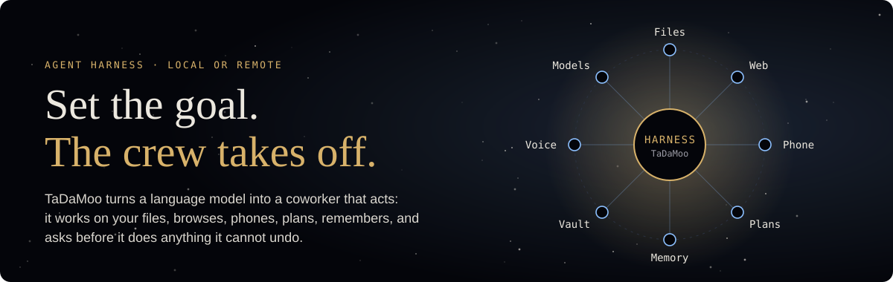
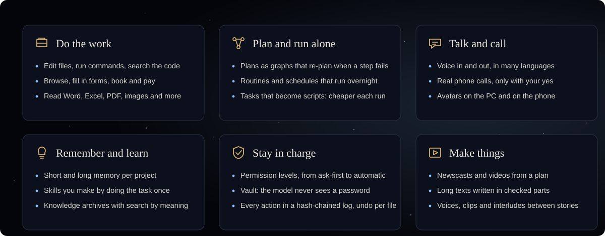
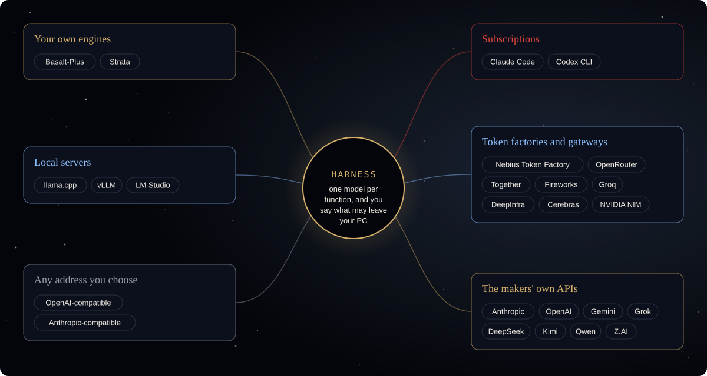
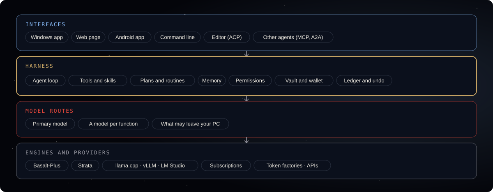

<p align="center">
  
</p>

<p align="center">
  <a href="https://tadamoo.com">tadamoo.com</a> ·
  <a href="#install">Install</a> ·
  <a href="#what-it-does">What it does</a> ·
  <a href="#any-model-any-way">Models</a> ·
  <a href="docs/harness-manual.md">Manual</a> ·
  English · <a href="README.it.md">Italiano</a>
</p>

# TaDaMoo

**TaDaMoo is an agent harness: the part that turns a language model into a coworker.** A model on its own answers questions. With TaDaMoo around it, the same model reads and edits your files, searches and browses the web, drives the computer with mouse and keyboard, fills in forms and books, places phone calls, keeps plans running overnight, remembers you, learns from what failed and asks before it does anything it cannot undo.

You choose the model: an engine on your own GPU, a subscription you already pay for, a token factory or a server on your network. You choose how much freedom it has. Every action lands in a log you can read, and every file it touches can be put back.

> **Licence.** TaDaMoo is not MIT-licensed and is not open source in that sense. Its new and modified code is under the **Basalt Win+GUI Community and Commercial License** ([LICENSE](LICENSE)): free for individuals (personal, research, hobby, educational and experimental use) and for organisations with annual gross revenue **under US$10,000,000**; an organisation at or above that figure needs a written Enterprise Commercial License to use it in production, and nobody may offer it as a paid managed service or hosted API without a separate agreement. Seeing the source on GitHub grants no other right. Commercial licences: [a.taini@gmail.com](mailto:a.taini@gmail.com). The details are in [License](#license).

## Why people use it

- **It does the work.** Files, shell, web, forms, documents, plans, and the computer itself, from one conversation.
- **It keeps going when you step away.** Plans and routines run on their own. What truly needs a person waits in one list, [Required actions](docs/actions.md), on the PC, in the browser and as a notification on the phone.
- **It remembers you and learns.** Long and short term memory about you, lessons from what failed and what worked, and skills it builds from your own prompts.
- **It gets cheaper the more you use it.** A task you repeat becomes a script: the model writes it once, and from then on it is plain code with the model only where the language must be understood.
- **It does not choke on long work.** Six layers keep a conversation inside the context window, a technical session does the housekeeping so the main context stays clean, and a long text is written in checked parts.
- **You hold the reins.** Four permission levels, a vault that keeps passwords and cards away from the model, a checkpoint for every file and a hash-chained log of every action.
- **Any model, switchable.** Change the primary model in one place, or give each function its own.
- **It follows you.** A Windows app, any browser, an Android app, a Telegram bot, the command line, or your editor over ACP. One server can serve all of them.

## What it does

<p align="center">
  
</p>

Everything below is in the repository. The [manual](docs/harness-manual.md) says how to use each function and [the reference](docs/harness.md) how it works.

### Tools that grow
- **MCP servers and MCP apps.** The tools of any MCP server, with sign-in (OAuth) to remote ones, and the page of an MCP app shown beside the conversation (the host side of the official extension). See [MCP apps](docs/mcp-apps.md).
- **Skills and plugins, found, installed and used.** Skills, plugins and MCP servers found on the PC are usable at once. A missing one is searched online, the best candidates are put to you (queued with a comparison when nobody is there), and one is installed with your yes, or by itself in Automatic; an install never runs a package's scripts. By hand: *Settings > Skills* or `/install-skill`; every skill is also a command, `/name text`. See [skills](docs/skills-manager.md).
- **The web.** `search_web`, `browse_url`, and Edge or Chrome driven for forms, bookings and purchases, in a browser built around the vault: a password or a card reaches a page only as a placeholder, and only on a site the entry names. Two drivers sit behind one selector in the Wallet: **agent-browser** by Vercel Labs (the default; it ships with TaDaMoo, compact page snapshots, tabs, sessions, video, a link to your own Chrome) or TaDaMoo's own driver. Both handle the vault, sign-ins and payments; agent-browser is not yet at parity with the own driver, and [the browsers page](docs/browser-backends.md) says where.
- **Computer control.** Eleven tools: a screenshot, the accessibility tree of any window (so even a model with no vision can act by element), mouse, keyboard, scroll and drag, on the screen you choose, with a stop at once when you move the mouse to a corner. On by default, within the permission levels. It uses **agent-desktop** by Vercel Labs, which ships with TaDaMoo and reads the accessibility tree of Windows, Linux and macOS and acts on elements without moving your mouse; the built-in backend (Windows and X11, no dependency) is the fallback. See [computer control](docs/computer-control.md).
- **Files and documents.** Read, list, search, edit and write files; attach text, code, CSV, JSON, Word, Excel, PowerPoint, PDF and images, read in pieces; `docx_edit` and `docx_create` for Word documents. Files the agent makes are checked before they are offered, and a button with the file's name saves them where you choose.
- **Code intelligence.** `repo_map` (the definitions of each source file, most relevant first), `repo_diagram` (import and folder diagrams worked out from the files, with no model), `search_code`, language-server diagnostics and go-to-definition.
- **Run code and delegate.** Python, JavaScript and TypeScript snippets, shell commands, background commands, and subagents for a task of their own.
- **Other agents.** The agent of any editor that speaks ACP (over stdio), an ACP client and an A2A client to talk to other agents. See [harness reference](docs/harness.md).
- **Agentic coding.** A role for each conversation, the checks a project seems to have, a class of safe verification commands, a worktree of its own for a conversation on a git folder, and blocks of changes you keep or undo. See [coding mode](docs/coding-mode.md).
- **Reverse engineering toolkit.** An optional switch adds the REA toolkit (MCP server and skill) and the programs it can use, each installed only on a click; experimental on Windows. See [REA](docs/rea.md).

### Conversations you can steer
- **A column of conversations** to open, delete or star, with the mode and the thinking level of each: *Plan only*, *Read only*, *Ask first*, *Automatic* (Shift+Tab changes it), and a thinking level per conversation.
- **More than thirty slash commands**: on the page (`/clear`, `/mode`, `/plan`, `/copy`, `/export`, `/branch`, `/rewind`, `/stop`, `/diff`), answered by the conversation's process (`/status`, `/context`, `/compact`, `/tools`, `/hooks`, `/mcp`, `/memory`, `/permissions`, `/audit`), requests for the model (`/init`, `/review`, `/security-review`, `/research`) and every skill.
- **A message while it works** is steered into the task, queued or treated as urgent; **Stop** means stop. It always knows the local date, time and timezone, without a tool call.
- **It asks well.** A card with choices, your own row and a recommended option first; it looks at each request before it works; chips for your next message that only fill the box; an optional rewrite of each message. Unattended runs never wait for any of it. See [intake](docs/intake.md).
- **Answers that show their work.** Pictures it found on the web with the source named, charts and diagrams the page draws, a *source* button that opens the page it used, and file buttons.
- **It remembers earlier conversations.** One index of everything you have discussed, searched by the agent (`search_past`) and by you.
- **A failure is handled, not hidden.** A busy or unreachable server is retried, a process that dies starts again from its history, a mangled tool call is mended, and loops and time limits stop a task that is going nowhere.

### Review, undo and replay
- **Changes panel.** Every edit, block by block, with *Keep* and *Undo*; a block is undone only while the file is exactly what the agent wrote, and edits made by a shell command are listed too.
- **Checkpoints and rewind.** Before an action changes files their previous content is kept outside the project; `/rewind`, *Back to here* and *Settings > Checkpoints* restore it, and a rewind takes a safety snapshot first.
- **Branches.** `/branch` copies a conversation at a request; a tree shows them; *Run both and compare* sends one request down two continuations and shows the answers and the files each changed side by side; *Merge and summarize* writes one synthesis of two branches.
- **Its own copy of a folder.** On a git folder a conversation can work in a worktree and you apply the diffs you choose as staged changes, never a commit.
- **Replay and traces.** A recorded session replays with its recorded answers (nothing runs) and saves as JSONL with secrets masked; the audit log is verified from the same page.

### Long work, without losing the thread
- **An agenda of tasks.** A register of what is open in each project, with subtasks down to ten levels, what is done and what is missing. It survives compaction, and you and the agent edit the same list. See [the register](docs/task-register.md).
- **Plans.** A goal becomes a plan as a graph of actions, sensors, decisions, merges and tasks handed to you; a failed step rewrites the plan, with history and restore; a plan can start another, start at a time you give in words, and be run as a script. See [orchestration](docs/orchestration.md).
- **Routines** run a prompt in a folder on a schedule, always Automatic. **Required actions** put everything that waits for you in one list.
- **Target Loop.** Works on a target until it is met, stalls or you stop it, judging each result against evidence. See [the Target Loop](docs/target-loop.md).
- **Long texts.** A request too long for one reply (a chapter, a report, a long translation) is planned in parts, each written in a call of its own, checked and corrected, then the whole is checked again. A reply cut by the output limit continues by itself. See [long answers](docs/longform.md).

### Context that holds
- **Six layers of reduction**, in order as the context fills: limits on tool output, masking of old results, compaction of older steps (even inside a single turn of hundreds of tool calls), a policy for a full chat (summarise the middle, drop the oldest or stop), short records for old long replies, and the **Billion Context** proxy; summary and sliding-window patterns are on top. See [the layers](docs/context-layers.md) and [compaction](docs/compaction.md).
- **A technical session.** A side session (a small second model, if you like) does the housekeeping: compacting, checking answers, rewriting a prompt, judging relevance, polishing lessons. The main conversation stays clean and little VRAM is spent.
- **A check on each answer.** A pipeline of judges looks at an answer before it reaches you.

### Memory and learning
- **Memory in the short and the long term.** About you: who you are, where you live, the people in your life, your tastes, and what you searched or worked on lately. Encrypted on disk, readable and editable by you, with a switch for what may go to a cloud model. Project notes, `AGENTS.md` rules read from the folder up, and reference documents sit beside it.
- **Lessons from past tasks.** What failed, what worked and how to avoid the mistake, kept as Markdown you can edit, for a project and for everywhere; a task leaves a line in an outcome log.
- **Skills made from your prompts.** Press *Make a skill* under a request, mark what changes, and the harness keeps what you did as a script you can run again, on this PC or any other (one `.pskill` file).
- **Knowledge archives (RAG).** Documents per project, read, split by structure, embedded and searched by meaning and by words, with figures and sources. See [RAG](docs/rag.md).

### Personalities, avatars and voice
- **Personalities.** A name, a way of talking, a standing prompt, a language, a voice, an avatar and a memory of its own that can learn from each conversation. Six ready-made colleagues are one button away: **the Critic** looks for what is wrong first; **the Analyst** thinks in parts, numbers and assumptions; **the Exact one** hunts for the detail that does not add up; **the Sceptic** wants evidence; **the Pragmatist** wants the simplest thing that works, soon; **the Brief one** answers first and stops. Edit or delete them like any other. See [personalities](docs/personas.md).
- **Voice.** Speech recognition (Whisper) and synthesis with Kokoro, Piper, XTTS v2, Chatterbox, CosyVoice 3, Qwen3-TTS, Orpheus and Dia, a voice for each personality, cloned voices kept on your PC.
- **Avatars.** A face with a voice: on the phone with Wav2Lip or mouth shapes, with no GPU; on the PC with MuseTalk, Wav2Lip v2, SadTalker and ER-NeRF, or one trained once from a video of the person (Ultralight-Digital-Human, FeatherTalk). Each has the personality and the memory of its own.
- **Talks like a person.** You can interrupt it: the voice lowers and it remembers what it had not yet said. It follows the language you speak. Hold to talk or continuous, dictation with a hotkey, push-to-talk and clipboard history on the desktop, and an ESP32 terminal.
- **Phone and meetings.** The assistant can join Meet, Teams or Zoom as an announced guest and suggest answers, and place or answer calls through a GSM modem or the phone, behind one policy that asks every time. See [voice](docs/voice/service.md).
- **Telegram.** A bot that talks to the agent with the same functions. See [Telegram](docs/telegram.md).
- **Import** from callAPIcall: personas, videos, memory and the prepared avatar.

### Many minds
- **War room.** A council of advisers with roles (proposer, critic, engineer) and a moderator debates a hard question round by round until they agree. Each adviser can have its own model and its own personality, so several LLMs argue the same problem. The cost is shown first. See [the council](docs/council.md).
- **Sessions that write to each other.** Type `@` and choose a session: it receives your text, an idle one wakes up and works, and both conversations show the exchange. See [session messaging](docs/session-messaging.md).
- **A model per function.** Chat, the agent's loop, voice, planner, compaction, the checks, quick jobs, relevance and the knowledge archives can each use a different model, with your yes for any that leaves your PC.

### Create and export
- **Images and video** made from the chat with models that fit beside the language model (`generate_image`, `generate_video`), and speech with many voices. See [media](docs/media/README.md).
- **Export a conversation** as Word, OpenDocument, PDF, Markdown or HTML, with the selection you choose.

### Phones and remote
- **The Android app**: chat, voice, avatars, an agent tab, a tab of the actions waiting for you with standard notifications, and a **+** menu for images, photos and documents from the phone, the server or the network. A phone tool tells the agent where you are.
- **Phones set up from the PC**: *Settings > Phones* installs Tailscale, lets phones connect by a key you show as a QR code, and gives each phone its own key.
- **Remote servers**: the desktop app connects to a server elsewhere, the key can be changed from the page, the app and any connected client, and a server runs with no web page at all.

### Stay in charge
- **Four permission levels** per conversation, *Plan only*, *Read only*, *Ask first* and *Automatic*, with plan mode, rules you can write as hooks, and a class of safe verification commands. Unattended runs never wait; only what involves other people, a booking or a resource the agent does not control stays in the queue.
- **Untrusted text stays text.** Pages, files and tool results are fenced as data, an instruction gate and a Rule of Two check watch for prompt injection, and what a stored lesson says is never obeyed as an order.
- **The Wallet vault** keeps cards, personal data and logins encrypted; the model writes only placeholders that are filled at the last step, and the agent can pay on the web within limits you set. A secrets broker keeps keys away from the model.
- **Every action is recorded** in an append-only, hash-chained log, with a checkpoint before each edit.
- **A security monitor** watches the network connections and disk writes of the model processes, and starts the Openweight Canary exfiltration test. See [the harness reference](docs/harness.md).

### Measure it
- **Evaluation** (`python -m tadamoo.eval`): pass^k, cost and cache use. **The energy of a task**: power and watt-hours while it ran. Replay of a recorded session. See [the harness reference](docs/harness.md).

## Any model, any way

<p align="center">
  
</p>

TaDaMoo is not tied to one engine or one vendor. Settings > Providers holds the connections, and each function of the harness can use the primary model or a model of its own. You also say what is allowed to leave your PC.

- **Your own engines.** Two, one active at a time, both run by the same server:
  - **Basalt-Plus** is our revision of Basalt (itself a fork of Strata) for NVIDIA Blackwell. It runs Qwen3.8-Flash-Next with the experts spread over the GPU, a second GPU, RAM and the CPU, adds a native Windows port, and a Loader that predicts memory and speed before anything is loaded.
  - **Strata** covers the hardware Basalt-Plus does not: RTX 20, 30 and 40, AMD, Intel, Apple silicon and unified-memory machines, with the Qwen3.6 and DeepSeek models. It runs as a managed child of the same server, with its own models tab in the Loader.
- **Subscriptions.** Claude through your Claude Code subscription and OpenAI through your Codex CLI subscription.
- **Token factories and gateways.** Nebius Token Factory, OpenRouter, Together, Fireworks, Groq, DeepInfra, Cerebras, Hyperbolic, Novita, SiliconFlow, Chutes, NVIDIA NIM and OrcaRouter.
- **The makers' own APIs.** Anthropic, OpenAI, Gemini, Grok, DeepSeek, Kimi, Qwen and Z.AI (API and coding plan).
- **Local servers.** llama.cpp (`llama-server`), vLLM and LM Studio, plus any address that speaks the OpenAI or the Anthropic API.

The server also speaks both APIs outward, so editors and tools you already use can talk to whatever model TaDaMoo is serving. See [the engines](docs/engines-protocol.md) and [the server API](docs/reference/server-api.md).

## Everywhere

<p align="center">
  
</p>

- **Windows app** with the local server, the Loader and a window on any server; a GUI-only install when the server lives elsewhere.
- **A server on Linux**, Docker or Kubernetes, reached from a browser, the desktop app or the phone, behind your own proxy and key. The key can be changed from the page, the app and any connected client.
- **Android app** with chat, voice, avatars and a tab of the actions waiting for you, with standard notifications.
- **Telegram, command line and editors**: `python -m tadamoo -p "task"`, and the agent of any editor that speaks ACP.

## Install

| What | Where | For |
|---|---|---|
| **Windows**, complete | [windows-v2.1](https://github.com/nuspy/tadamoo/releases/tag/windows-v2.1) | the app, the engine, the server and Python on one PC |
| **Windows**, GUI only | [windows-gui-only-v2.1](https://github.com/nuspy/tadamoo/releases/tag/windows-gui-only-v2.1) | a window on a server that runs elsewhere |
| **Linux**, complete | [linux-complete-v2.1](https://github.com/nuspy/tadamoo/releases/tag/linux-complete-v2.1) | the harness, the installer and the Basalt-Plus engine |
| **Linux**, server | [server-linux-v2.1](https://github.com/nuspy/tadamoo/releases/tag/server-linux-v2.1) | the harness and the installer |
| **Android** | [android-v2.1](https://github.com/nuspy/tadamoo/releases/tag/android-v2.1) | the phone app |
| **Mac** | compile from this repository | the window on a server (prepared in [deploy/mac](deploy/mac/README.md)) |

agent-desktop and agent-browser (Vercel Labs, Apache-2.0) are built from `third_party/` and ship inside the Windows and Linux packages.

On Linux:

```
tar xzf TaDaMoo-linux-complete-v2.1.tar.gz && cd tadamoo-2.1
sudo deploy/linux/install.sh install --components harness,basalt --public-name tadamoo.example.org --proxy nginx --generate-key
```

The installer takes the engine you ask for (`--components harness,basalt,strata`), writes the systemd service and a ready recipe for nginx, Caddy or Nginx Proxy Manager, and fetches Strata from its own release with a checksum (`--strata-download`). Docker files and a Helm chart for Kubernetes and k3s are in `deploy/`. See [docs/deploy.md](docs/deploy.md).

Basalt-Plus needs an NVIDIA Blackwell GPU (RTX 50 series, compute capability 12.0). Without one the harness still runs through any provider above.

## Learn more

- [Manual](docs/harness-manual.md) and [harness reference](docs/harness.md)
- [Install on a server](docs/deploy.md), [the desktop app and remote servers](docs/desktop-servers.md), [GUI-only for Windows](docs/windows-gui-only.md), [server security](docs/server-security.md)
- [Required actions](docs/actions.md), [orchestration: plans, routines, cron](docs/orchestration.md), [the council](docs/council.md), [the register of tasks](docs/task-register.md)
- [Context layers](docs/context-layers.md), [compaction](docs/compaction.md), [personalities](docs/personas.md), [memory](docs/harness-study/memory.md), [RAG](docs/rag.md)
- [Voice and avatars](docs/voice/service.md), [media](docs/media/README.md), [Telegram](docs/telegram.md), [computer control](docs/computer-control.md)
- [Engines](docs/engines-protocol.md), [building from source](docs/building.md), [the `.basalt` model file](docs/model-file.md)
- [Reference](docs/reference/differences-from-basalt.md): what this fork changes in Basalt, the settings one by one, the Windows scripts and the original Basalt README

## Status

TaDaMoo is under active development. Some parts were built and tested with stand-ins and are not yet proven on every real device: parts of the voice stack, the phone avatars, the remote-server setup and computer control, whose test on a real screen is still to be run. Each documentation page says what was run and what was not.

## License

The code in this repository is not licensed under one licence. What is whose:

- **New and modified code** (the harness, the desktop and Android apps, the Windows port of the engine, the Loader, the installers, the tools) belongs to Andrea Taini and is licensed **only** under the **Basalt Win+GUI Community and Commercial License**, version 1.0 ([LICENSE](LICENSE)). It is **not** licensed under MIT.
- **Free use.** An individual using it for personal, research, hobby, educational or experimental purposes, and a company, institution or self-employed person whose consolidated annual gross revenue, affiliates included, is strictly below US$10,000,000.
- **Enterprise licence.** An entity at or above US$10,000,000 may not use it in production or for internal operations without a written Enterprise Commercial License; a 30-day non-production evaluation is allowed. Ask at [a.taini@gmail.com](mailto:a.taini@gmail.com).
- **For everyone.** No offering it, its API or its inference as a paid managed service or hosted API without a separate written agreement; no splitting revenue or using intermediary entities to stay under the threshold; no use of the names or trademarks beyond attribution; a redistribution must carry the whole licence text and [THIRD_PARTY_LICENSES](THIRD_PARTY_LICENSES) and say what was modified. Breaking the terms ends the licence.
- **Other people's code keeps its own licence.** Strata, upstream Basalt, ggml, llama.cpp and other third parties are under their original licences, mostly MIT, listed in [THIRD_PARTY_LICENSES](THIRD_PARTY_LICENSES); `third_party/agent-desktop` and `third_party/agent-browser` are Apache-2.0 (Vercel Labs). The model files derive from Qwen3.8-Flash-Next and are under the [Qwen Community License 1.0](https://huggingface.co/Qwen/Qwen3.8-Flash-Next/blob/main/LICENSE).

The summary is for orientation; the text of [LICENSE](LICENSE) is what binds.

## Credits

Basalt-Plus is a fork of [Basalt](https://github.com/jesdga95/basalt) by jesdga95 (MIT), itself a fork of [Strata](https://github.com/Niko1221/Strata) by Niko1221 (MIT). The copyright notices of both projects and of the code they include (ggml, llama.cpp and others) are kept in [LICENSE](LICENSE) and [THIRD_PARTY_LICENSES](THIRD_PARTY_LICENSES). The model files derive from Qwen3.8-Flash-Next and are under the [Qwen Community License 1.0](https://huggingface.co/Qwen/Qwen3.8-Flash-Next/blob/main/LICENSE), not MIT.

[agent-desktop](https://github.com/vercel-labs/agent-desktop) and [agent-browser](https://github.com/vercel-labs/agent-browser) are projects of Vercel Labs (Apache-2.0). They are built from `third_party/` and ship inside the Windows and Linux packages; their licence is in [THIRD_PARTY_LICENSES](THIRD_PARTY_LICENSES).

Website: [tadamoo.com](https://tadamoo.com) · Contact: [a.taini@gmail.com](mailto:a.taini@gmail.com) · Repository: [github.com/nuspy/tadamoo](https://github.com/nuspy/tadamoo)
